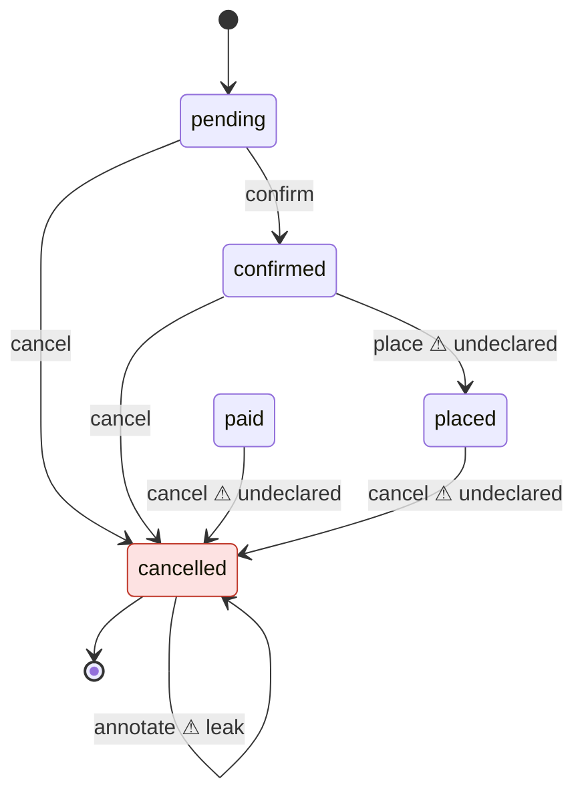

# domain-integrity

[](https://www.npmjs.com/package/domain-integrity)
[](https://github.com/mannkostir/domain-integrity/actions/workflows/ci.yml)
[](LICENSE)

**Your aggregates have lifecycles. Nothing checks them.**

Your tests pass and your types check, yet a closed account still accepts deposits and a cancelled order can still be edited. Lifecycle rules live in people's heads, and every new method, whether you or a coding agent wrote it, can quietly break one.

`domain-integrity` reads your aggregates with the TypeScript type checker. It works out which states each method can actually run from, compares that with a three-line declaration of what you intended, and fails CI where the two disagree.

It also follows in-process domain events. It finds the handlers registered for each event class and reports the ones that can never run, the ones that do not match their event, events nobody handles, and sagas with no failure path.

## See it catch a bug

A typical aggregate. Once an account is closed, nothing should happen to it, but nothing enforces that:

```ts
import { AggregateRoot } from './aggregate-root';

export class Account extends AggregateRoot<{ balance: number }> {
  private closedAt: Date | null = null;
  private lockedAt: Date | null = null;

  static open(): Account {
    return new Account({ balance: 0 });
  }

  deposit(amount: number): void {
    if (amount < 1) throw new Error('Amount must be positive');
    this.props.balance += amount;
  }

  withdraw(amount: number): void {
    if (this.props.balance < amount) throw new Error('Insufficient funds');
    this.props.balance -= amount;
  }

  lock(): void {
    if (this.lockedAt) throw new Error('Already locked');
    this.lockedAt = new Date();
  }

  close(): void {
    if (this.props.balance > 0) throw new Error('Balance remains');
    this.closedAt = new Date();
  }
}
```

Write the rule down once:

```ts
import { defineDomain, lifecycle } from 'domain-integrity';
import { Account } from './src/account';

export default defineDomain({
  lifecycles: [lifecycle(Account, { states: { closedAt: { terminal: 'set' } } })],
});
```

Run `npx domain-integrity check`:

```text
error terminal-state-leak  Account.deposit()  src/account.ts:11
  deposit() can run after closedAt is 'set'.
  Fix: Guard deposit() so it cannot run when closedAt is 'set', or list it in allowAfterTerminal if that is intended.

error terminal-state-leak  Account.withdraw()  src/account.ts:16
  withdraw() can run after closedAt is 'set'.
  Fix: Guard withdraw() so it cannot run when closedAt is 'set', or list it in allowAfterTerminal if that is intended.

error terminal-state-leak  Account.lock()  src/account.ts:21
  lock() can run after closedAt is 'set'.
  Fix: Guard lock() so it cannot run when closedAt is 'set', or list it in allowAfterTerminal if that is intended.

error terminal-state-leak  Account.close()  src/account.ts:26
  close() can run after closedAt is 'set'.
  Fix: Guard close() so it cannot run when closedAt is 'set', or list it in allowAfterTerminal if that is intended.

4 errors, 0 warnings
```

Every method still runs on a closed account, including `close()` itself. The exit code is `1`, so CI fails.

## See the lifecycle

`npx domain-integrity show` draws each aggregate's real state machine as Mermaid, which renders directly on GitHub. Here is an `Order` whose declaration says `place` runs from `paid` and `cancel` runs only from `pending` or `confirmed`:



The picture shows four bugs:
- **`paid` is unreachable.** No code ever sets it.
- **`place` skips payment.** It runs straight from `confirmed`.
- **`cancel` runs too late.** It still works after the order is paid or placed.
- **`annotate` leaks past the end.** It still changes a cancelled order.

`check` reports each of them, with a fix.

## Quick start

```bash
npm i -D domain-integrity
npx domain-integrity init
npx domain-integrity check
```

`init` finds your aggregates and suggests their state fields and terminal values. It writes `domain.config.ts` with real imports, so renaming an enum member makes `check` fail instead of silently drifting. When your tsconfig resolves modules as `node16` or `nodenext`, the imports carry runtime extensions: `.js`, or `.mjs` and `.cjs` for `.mts` and `.cts` files. You review the suggestions once; after that, `check` runs on every commit. For each suggestion, `Y` or Enter declares it as suggested, `n` skips it, and `e` asks for each field's terminal values: type them comma-separated from the field's known values (a value that contains a comma goes on its own), `-` for none, or press Enter to keep the suggestion. An unknown value is named and asked again, and nothing is written until every suggestion is answered.

When a timestamp or other nullable field is only ever set by methods that also set an enum or literal-union status field, and only to the status's suggested terminal values, `init` leaves the nullable field's terminal list empty. The status already marks the end of that lifecycle, and a second terminal field would report methods that are guarded on the status. Both writes must be plain `this.field = value;` statements (or `this.props.field = value;`), and the status write must sit in the same or an enclosing block, either before the timestamp write or after it with no `return`, `throw`, `break`, `continue`, `await`, `for await`, `yield`, call, `new` or tagged template in between, because a call can throw before the status is written. Code that runs implicitly, such as a getter read or the `toString` behind a template literal, is not treated as a call. A status write behind its own `if`, or a timestamp written inside a `?:`, `&&` or `||` expression, keeps the suggestion. So does a timestamp also written anywhere `init` cannot follow: by a getter or setter, a property initializer or closure, a static member, a subclass, another instance, a computed key, a compound or destructuring assignment, a `for…of` or `for…in` target, `delete`, a plain assignment or `Object.assign` outside the class (a write through a generic helper or `Reflect.set` there is not seen), `Object.assign(this, …)` or `this` passed to a function in a method, or a write whose value cannot be resolved. Any escape of `this` outside the aggregate's instance methods, in the class, a subclass, including a class expression that extends it, or any project base class including one listed in `aggregates.baseClasses`, such as `this` passed to a function, aliased, returned or stored in the constructor, a method of a listed base class, a property initializer or a closure, keeps the suggestion for every field; comparing `this` with `===` or `!==` is not an escape. A write in a method of a base class listed in `aggregates.baseClasses` counts as one `init` cannot follow, and library base classes are not scanned. Plain constructor writes and `Object.assign(this, …)` in the constructor set the initial state and do not count. A timestamp set on its own, say `lockedAt` set by `lock()`, keeps its suggestion.

`init` discovers aggregates as classes extending or implementing `AggregateRoot` or `Entity`. If yours use another base class or interface, pass it with `--base-class`, once for each name. In a new config the names you pass replace `AggregateRoot` and `Entity`; to keep one of them, pass it too:

```bash
npx domain-integrity init --base-class AggregateRoot --base-class MyAggregateBase
```

In an existing config the names are added: to `AggregateRoot` and `Entity` when it lists no base classes yet, to its list otherwise. `init` records the names in `aggregates.baseClasses`, so `check` finds the same aggregates. When it finds none, it prints the exact command to run.

**Requirements:** Node 22 or 24 (`engines: >=22`), a TypeScript 5+ project, and `strictNullChecks` for nullable state fields.

## What it checks

| Check | Catches |
|---|---|
| [`terminal-state-leak`](#terminal-state-leak) | A public method that can still change the aggregate after it reached a terminal state |
| [`unreachable-state`](#unreachable-state) | A state your type declares but no code ever assigns |
| [`outside-mutation`](#outside-mutation) | State assigned from outside the aggregate, for example from a service, mapper or specification. A write through the aggregate's own setter is not one. Assignments in test files are not reported by default. |
| [`transition-drift`](#transition-drift) | A method that can run from states you did not declare, or that sets the state field without an entry in `transitions` |
| [`transition-missing`](#transition-missing) | A method that can no longer run from a state you declared for it. A warning. |

All lifecycle checks are errors except `transition-missing`, which is a warning.

Five more checks cover in-process event flows. All of them are errors:

| Check | Catches |
|---|---|
| [`dead-handler`](#dead-handler) | A handler is registered for an event class that production code never constructs |
| [`handler-payload-mismatch`](#handler-payload-mismatch) | A handler is registered for one event class but declares its event as an unrelated class |
| [`unhandled-event`](#unhandled-event) | A declared in-process event is constructed but has no handler |
| [`saga-missing-failure-path`](#saga-missing-failure-path) | A saga handles the success event of a declared outcome but not its failure event |
| [`undispatched-events`](#undispatched-events) | An event method stores events in a buffer that production code never reads or drains |

Every check has one severity. An error is a broken rule: any error finding not in the baseline makes `check` exit `1`. A warning is a declaration that no longer matches the code, such as a transition no method can take any more: it is reported in every format, but a run whose only new findings are warnings still exits `0`. SARIF results carry the severity as their `level`.

`dead-handler` and `handler-payload-mismatch` always run, and so does `undispatched-events` while `events.raiseMethods` is non-empty. `unhandled-event` runs only for the classes listed in `events.inProcess`, and `saga-missing-failure-path` only for sagas declared with `saga()`. See "The declaration".

These shapes are recognised as handlers:
- a configured decorator on a class, where the `handle` method is the handler and its first parameter is the event, or on a method. The decorator is matched by its name, written plainly or as `ns.Name`, called or not; any other decorator expression, such as `@(list[0])` or `@factory()()`, is never a handler. An object-literal argument is read as options and skipped, so `@OnEvent(X.name, { async: true })` registers `X`;
- `register(callback, X)` or `register(callback, X.name)`, with exactly these two arguments in this order, where the callback is `this.m`, `this.m.bind(this)` or an inline arrow or function expression. A call without a callback of that shape first is not a handler registration and is ignored, such as a DI container's `container.register(Logger, { useValue: logger })`. A key that is a library class is ignored too, and so is a callback whose body constructs the keyed class, such as `container.register((config) => new Db(config), Db)`, which is a factory;
- `subscribedTo()` returning an array literal, such as `[X, Y]`;
- a `@Saga()` property that uses `ofType(X, …)`.

A project with event handlers and no aggregates is accepted. A project with nothing to check is handled as follows by `check`, `show` and `context`; each message starts with the number of source files loaded:

| Project | Exit | Message |
|---|---|---|
| The tsconfig, and the tsconfigs it references, include no source files other than the config | `2` | Says so and points you to `-p` or `references` |
| No aggregates are found for `aggregates.baseClasses`, and there are no event handlers or event flows | `2` | "No aggregates found", with the base classes and handler shapes it searched for, preceded by a `problem:` line for each problem an analyzer met, such as a declared event outside the analysed files |
| Aggregates are found, but the config declares no lifecycles and there are no event handlers or event flows | `0` | A notice on stderr pointing you to `init` |

In the last case stdout keeps the normal output, so JSON and SARIF reports stay valid: `check` reports no findings, `show` prints nothing, and `context` prints nothing; `context --write` still writes its marked section, with nothing between the markers.

Only public methods are judged. Private and protected helpers, such as event-sourcing appliers, are covered by the public command that calls them.

Every file your tsconfig includes is scanned, tests too, but an assignment in a test file is not reported as `outside-mutation`. Test files are `*.spec.*`, `*.test.*` and anything under `__tests__/`, `test/` or `tests/`, relative to the tsconfig directory, the same rule the event-flow checks use. Such an assignment still counts as evidence: its value counts as assigned for `unreachable-state`, so a state that only a test builder sets is not reported as unreachable, and on an undeclared aggregate it counts as a write outside the class, which keeps an `init` suggestion. Set `rules: { 'outside-mutation': { testFiles: true } }` to report test-file assignments too. Production code is judged the same either way.

This default changed in 0.3.0. Earlier versions reported assignments in test files as `outside-mutation`; set `rules: { 'outside-mutation': { testFiles: true } }` to keep that.

To leave tests out of every analysis, give `check` a tsconfig that excludes them. Excluded files are no longer evidence either, so a state that only a test assigns can then be reported as `unreachable-state`:

```json
{
  "extends": "./tsconfig.json",
  "exclude": ["node_modules", "test", "**/*.spec.ts", "**/*.test.ts"]
}
```

```bash
npx domain-integrity check -p tsconfig.domain.json
```

In an Nx workspace a library's `tsconfig.json` usually references a `tsconfig.spec.json`, which brings its tests in. Keeping it no longer produces `outside-mutation` findings by default, since its tests only count as evidence. Pass a tsconfig that references only the `tsconfig.lib.json` and `tsconfig.app.json` files to leave them out entirely.

### Rule reference

#### terminal-state-leak

A public method has no guard that stops it once a state field holds a declared terminal value, so it can still change an aggregate that is meant to be finished. A cancelled order that can still be shipped, or a closed account that still takes deposits, is a broken business rule.

Guard the method with an early return or throw on the state field so it cannot run from the terminal value. If changing a finished aggregate is intended, as for a remove method, list the method in `allowAfterTerminal` in `domain.config.ts`. Accept the finding into the baseline only while it is a known defect you mean to fix.

#### unreachable-state

A value of the state field type is never assigned anywhere in the analysed code, so no aggregate can ever reach it. Either the method that should move the aggregate into that state is missing, or the type carries a value that no longer means anything.

Add the method that moves the aggregate into that value, or remove the value from the type. Accept the finding into the baseline only if the value is honestly set by code the analysis cannot see, such as a database write.

#### outside-mutation

A state field is assigned from code outside the aggregate, such as a service, mapper or specification, so the aggregate's guards and transitions are bypassed. A write through the aggregate's own setter is not reported, and neither are assignments in test files unless `rules['outside-mutation'].testFiles` is true.

Move the change into a method on the aggregate so its guards apply, and call that method instead. Accept the finding into the baseline only if the assignment honestly has to stay where it is, such as a persistence mapper that rebuilds a stored aggregate.

#### transition-drift

A method can run from states that its entry in `transitions` does not list, or it sets the state field while `transitions` has no entry for it. The code then allows more than the declared lifecycle, so the declaration no longer describes what the aggregate does.

Add a guard that excludes the extra states, or, if the code is right, add those states to the method's entry in `transitions` in `domain.config.ts`, or add an entry for a method that has none. Accept the finding into the baseline only while it is a known defect you mean to fix.

#### transition-missing

A method's guard keeps it from running in a state that its entry in `transitions` lists, so the declaration promises a transition the code no longer offers. It is a warning: the code is not breaking a rule, but the declaration has drifted from it.

Remove the state from the method's entry in `transitions` in `domain.config.ts`, or relax the guard if the method should still run from it. Accept the finding into the baseline only while it is a known gap you mean to resolve.

#### dead-handler

A handler is registered for an event class that no production code constructs, so the handler never runs. Usually the event was never published where it happens, or it was removed and the handler was left behind.

Publish the event where it happens, or delete the handler. Accept the finding into the baseline only if the event is honestly constructed by code the analysis cannot see, such as code outside the analysed files.

#### handler-payload-mismatch

A handler is registered for one event class but types its event parameter as an unrelated class. The handler is then handed an event of a different class than it expects.

Type the parameter as the registered event class, or register the handler for the class it declares. Accept the finding into the baseline only while it is a known defect you mean to fix.

#### unhandled-event

An event class listed in `events.inProcess` is constructed in production code, but no handler is registered for it, so the event is raised and nothing reacts to it. It runs only for the classes declared in `events.inProcess`.

Add a handler for the event, or, if it is consumed elsewhere, such as by another process, remove it from `events.inProcess` in `domain.config.ts`. Accept the finding into the baseline only while it is a known gap you mean to close.

#### saga-missing-failure-path

A saga declared with `saga()` handles the success event of a declared outcome but not its failure event, so a failure leaves the process stuck halfway with nothing to compensate. It runs only for sagas and outcomes declared in `events.sagas`.

Handle the failure event in the saga, for example with a compensating command. If the outcome is declared wrongly, correct it in `events.sagas` in `domain.config.ts`. Accept the finding into the baseline only if the failure is honestly handled somewhere the analysis cannot see.

#### undispatched-events

An event method pushes events onto a private buffer that no production code reads or drains, so every event raised into it is silently lost. It is reported only when the analysis can prove that nothing reads the buffer.

Dispatch the events in the buffer after saving the aggregate and clear it, or stop raising them. Accept the finding into the baseline only if the buffer is honestly read by code the analysis cannot see, such as reflection or library code.

## Commands

| Command | What it does |
|---|---|
| `init [--yes] [--base-class <name>]` | Suggests and writes declarations. On an existing config it only adds new aggregates. It asks to declare (`Y`), skip (`n`) or edit (`e`) each suggestion, which needs an interactive terminal; without one it exits `2` unless `--yes` accepts them all, and a run with nothing to declare exits `0`. Editing takes each field's terminal values from its known values, `-` for none. If the input ends before every suggestion is answered, it exits `2` and writes nothing. `--base-class` is repeatable and records each name in `aggregates.baseClasses`. In a new config the names replace `AggregateRoot` and `Entity`; to keep one, pass it too. In an existing config they are added to the defaults when it lists no base classes yet, to its list otherwise. |
| `check [--format text\|json\|sarif]` | Reports findings. Exit `0` clean or warnings only, `1` error findings, `2` config, project or usage error, or an internal error. |
| `show [name]` | Prints Mermaid state diagrams, then an event-flow flowchart. Takes an aggregate class name, an event name, or `path:Class` such as `src/orders/order.ts:Order`, with the path relative to the repository root; a file outside the repository appears as `../…`; `./` prefixes and backslashes are accepted. When several aggregates share the class name, a plain name exits `2` and lists the `path:Class` candidates. |
| `context [--write AGENTS.md]` | Writes a summary of lifecycles and event flows for coding agents, with paths relative to the repository root. |

Every command takes `-p <tsconfig>` and `-c <config>`, which default to `tsconfig.json` and `domain.config.ts`. The config is read statically and never executed.

`--version`, or `-V`, prints the version and exits `0`.

The JSON report is described under [JSON report](#json-report). The SARIF report carries the version in `tool.driver.version` and the project homepage in `tool.driver.informationUri`. Each SARIF rule carries its full description, its remedy as help text, a `helpUri` linking to its entry in the rule reference, and its severity as `defaultConfiguration.level`. Each SARIF result names its rule by `ruleId` and `ruleIndex`, carries the finding's message as `message.text` and its fix in `properties.fix`, and has a `partialFingerprints` entry `domainIntegrity/v2` holding its serialized identity, a JSON array of the rule and the identity fields as listed under [Adopt it in an existing codebase](#adopt-it-in-an-existing-codebase). Each location is an `artifactLocation` whose `uri` is relative to the repository root and whose `uriBaseId` is `%SRCROOT%`. When a baseline is applied, whether given with `--baseline` or loaded from `domain-integrity.baseline.json`, known findings follow the new ones as results with an `external` suppression; they never affect the exit code. Findings suppressed in the config follow them as results whose `suppressions` entry has the kind `external` and the suppression's reason as its justification.

If one analyzer crashes, the command prints `internal error in <analyzer>, please report (domain-integrity <version>)` with a short stack trace, still prints the other analyzers' results, and exits `2`; `--update-baseline` and `context --write` then write nothing.

### JSON report

`check --format json` prints one object with the keys `version`, `tool`, `summary`, `findings`, `known`, `suppressed` and `problems`, in that order. `version` is the format version, currently `2`. It is raised only by a breaking change: a key removed or renamed, or the meaning or type of a value changed. A new key, rule or problem code keeps it, so code that reads the keys it knows keeps working. `tool` holds the package `name` and `version`. `summary` counts the new errors and warnings, the known findings, the findings suppressed in the config and the problems, so `errors` and `warnings` match the text summary line. `known` holds the findings accepted by a baseline, in the same shape as `findings`. `suppressed` holds the findings accepted by `suppress()` under [Rules and suppressions](#rules-and-suppressions), each in the shape of a finding followed by a `reason` key holding the suppression's reason.

```json
{
  "version": 2,
  "tool": {
    "name": "domain-integrity",
    "version": "0.3.0"
  },
  "summary": {
    "errors": 5,
    "warnings": 1,
    "known": 0,
    "suppressed": 0,
    "problems": 0
  },
  "findings": [
    {
      "ruleId": "unreachable-state",
      "severity": "error",
      "analyzer": "lifecycle",
      "identity": {
        "rule": "unreachable-state",
        "aggregate": "src/order.ts:Order",
        "field": "status",
        "value": "PAID"
      },
      "location": {
        "file": "src/order.ts",
        "line": 6
      },
      "message": "status value 'paid' is never assigned.",
      "fix": "Add the method that moves Order into 'paid', or remove the value from the type.",
      "details": {
        "aggregate": "Order",
        "field": "status",
        "value": "PAID"
      }
    }
  ],
  "known": [],
  "suppressed": [],
  "problems": []
}
```

Every finding has the keys `ruleId`, `severity`, `analyzer`, `identity`, `location`, `message`, `fix` and `details`, in that order, and every key is always present; a value that does not apply is `null`, never omitted. `severity` is `error` or `warning`, and `analyzer` is `lifecycle` or `event-flow`. `identity` is the finding's identity, an object whose first key is `rule`, followed by the identity fields of the rule in the order of the table; it is the baseline entry without `count`. `location` holds `file`, relative to the repository root with `/` separators, and `line`. `details` holds the fields of the rule, in the order of the table. State values in `details` and in `identity` are the literal values the config uses, such as `PAID` for a member declared as `paid = 'PAID'`, never enum member names; the message shows the member name. `aggregate`, `event`, `saga`, `owner` and the other names in `details` are the display names the messages use, plain class names; the `path:Class` ids appear only in `identity`. In `undispatched-events`, `raisers[]` holds display names too. The only nullable detail is `handler`, a string or `null`.

| `ruleId` | `details` | Identity fields |
|---|---|---|
| `terminal-state-leak` | `aggregate`, `method`, `field`, `values[]` | `aggregate`, `method`, `field`, `values[]` |
| `unreachable-state` | `aggregate`, `field`, `value` | `aggregate`, `field`, `value` |
| `outside-mutation` | `aggregate`, `field`, `scope` | `aggregate`, `field`, `file`, `scope` |
| `transition-drift` | `aggregate`, `method`, `field`, `kind` (`extra` or `undeclared`), `values[]` | `aggregate`, `method`, `field`, `kind` |
| `transition-missing` | `aggregate`, `method`, `field`, `values[]` | `aggregate`, `method`, `field` |
| `dead-handler` | `event`, `handler` | `event`, `handlerClass`, `handlerMethod` |
| `handler-payload-mismatch` | `event`, `handler`, `declared[]` | `event`, `handlerClass`, `handlerMethod`, `declared[]` |
| `unhandled-event` | `event` | `event` |
| `saga-missing-failure-path` | `saga`, `success`, `failure` | `saga`, `success`, `failure` |
| `undispatched-events` | `owner`, `buffer`, `method`, `raisers[]` | `owner`, `buffer` |

For `transition-drift`, `values` lists the extra states for `extra` and is empty for `undeclared`; for `transition-missing` it lists the missing states. Neither enters the identity.

A problem is something the analysis could not resolve, such as a declared field that does not exist. Problems are not findings: they have no identity, never enter a baseline, and a run with problems exits `2`; because its findings are then incomplete, it does not report stale baseline entries. Each has the keys `code`, `analyzer`, `message` and `details`, in that order, and the same message is printed on stderr as a `problem:` line.

| `code` | `analyzer` | `details` |
|---|---|---|
| `state-field-accessor` | `lifecycle` | `aggregate`, `field` |
| `state-field-missing` | `lifecycle` | `aggregate`, `field` |
| `state-field-unsupported-type` | `lifecycle` | `aggregate`, `field`, `type` |
| `unknown-state-value` | `lifecycle` | `aggregate`, `field`, `value`, `known[]` |
| `transition-method-missing` | `lifecycle` | `aggregate`, `method` |
| `event-not-analysed` | `event-flow` | `event` |
| `saga-outcome-unhandled` | `event-flow` | `saga`, `success`, `failure` |

A JSON Schema describes the report. The package ships it as `schema/report.schema.json` and exports it as `domain-integrity/schema/report.json`; it is also available at [`https://unpkg.com/domain-integrity/schema/report.schema.json`](https://unpkg.com/domain-integrity/schema/report.schema.json). Its `$id` is `urn:domain-integrity:report:v2`. It is strict, with `additionalProperties` set to `false` throughout, and it describes exactly the output of the version it ships with: a newer release may add keys, rules and problem codes that an older schema rejects, so validate with the schema of the installed version.

## Built for codebases that agents write

Agents produce code that passes tests and still breaks the domain. Give them the rules before they write:

```bash
npx domain-integrity context --write AGENTS.md
```

This writes each aggregate's states, terminal values and allowed transitions, plus an "Event flows" section, into a marked section of `AGENTS.md`, or `CLAUDE.md`, and leaves the rest of the file untouched. The agent reads the rules up front, and `check` catches whatever slips through.

## Adopt it in an existing codebase

You don't have to fix everything first. Record today's findings and fail only on new ones:

```bash
npx domain-integrity check --update-baseline
npx domain-integrity check
```

`--update-baseline` writes `domain-integrity.baseline.json` in the current working directory, or the file given with `--baseline`, and reports how many entries it wrote, such as `Baseline written to domain-integrity.baseline.json with 12 entries.` The count is the number of distinct identities. Each run rewrites the file from the current findings without reading the old one, so entries that no longer match a finding are removed. A plain `check` loads the same file from the current working directory when it exists, and runs without a baseline when it does not. `--baseline <path>` applies another file instead and wins over the default one; `check` exits `2` when that file is missing.

In the text output, known findings collapse into the summary line, which names the baseline applied:

```text
0 errors, 0 warnings, 12 known from baseline domain-integrity.baseline.json
```

`--show-known` lists them in full after the new ones, each marked `(baseline)`. The JSON and SARIF reports always carry them.

A stale entry is a baseline entry that no longer matches the current findings: either no current finding has its identity, or fewer findings have it than its `count` accepts. The text output lists stale entries before the summary line, with their count and identities in the form `rule name=value …`, arrays joined with `,` and `null` written as `-`. An entry whose count is only reduced ends in `(accepts <b>, found <n>)`:

```text
2 stale baseline entries, remove with --update-baseline:
  outside-mutation aggregate=src/order.ts:Order field=status file=src/mapper.ts scope=OrderMapper.toDomain (accepts 2, found 1)
  terminal-state-leak aggregate=src/order.ts:Order method=annotate field=status values=CANCELLED
```

Stale entries never change the exit code. They are not reported when the run has problems or an internal error, because its findings are then incomplete.

A baseline entry is the identity of a finding plus a `count`, not a line number, so unrelated edits don't break the baseline. The file has a `version`, currently `2`, and a `findings` array sorted by identity:

```json
{
  "version": 2,
  "findings": [
    {
      "rule": "outside-mutation",
      "aggregate": "src/order.ts:Order",
      "field": "status",
      "file": "src/mapper.ts",
      "scope": "OrderMapper.toDomain",
      "count": 2
    }
  ]
}
```

Every id in an identity is `path:Class`, where the path is relative to the repository root. The repository root is the nearest directory, starting with the one holding the tsconfig and going up, that contains a `.git` entry, a directory or a file; without one it is the tsconfig directory. A per-package tsconfig in a monorepo therefore yields paths from the top of the repository. A file outside the repository appears as `../…`. The identity fields of each rule are, in order after `rule`:

| `rule` | Identity fields |
|---|---|
| `terminal-state-leak` | `aggregate`, `method`, `field`, `values[]` |
| `unreachable-state` | `aggregate`, `field`, `value` |
| `outside-mutation` | `aggregate`, `field`, `file`, `scope` |
| `transition-drift` | `aggregate`, `method`, `field`, `kind` (`extra` or `undeclared`) |
| `transition-missing` | `aggregate`, `method`, `field` |
| `dead-handler` | `event`, `handlerClass`, `handlerMethod` |
| `handler-payload-mismatch` | `event`, `handlerClass`, `handlerMethod`, `declared[]` |
| `unhandled-event` | `event` |
| `saga-missing-failure-path` | `saga`, `success`, `failure` |
| `undispatched-events` | `owner`, `buffer` |

`aggregate`, `event`, `saga`, `success`, `failure`, `owner`, `handlerClass` and the entries of `declared` are `path:Class` ids. `handlerClass` and `handlerMethod` are `null` for an inline handler. `values` and `declared` are sorted, and a baseline is read with them sorted too, so their order in the file does not matter. For `outside-mutation`, `file` is the file of the write and `scope` is the enclosing name chain, such as `OrderMapper.toDomain`, or `<module>` at the top level. State values are the literal values the config uses, so renaming an enum member keeps its identity and changing the value changes it. The JSON `identity` of a finding is the same object without `count`, and the SARIF `domainIntegrity/v2` fingerprint is its serialized form.

Moving a file or renaming a class changes the ids of its aggregates, events and sagas, and so the identities of their findings; their known findings come back as new until you run `--update-baseline` again. Adding, removing or renaming an unrelated class that shares a class name with another never changes an existing identity.

Several findings can share one identity, such as two writes in the same function. The entry's `count` is how many of them the baseline accepts. When a run finds no more than `count`, all of them are known. When it finds more, all of them are reported as new, because the baseline cannot tell which one is the addition, and each ends in `(baseline accepts <b> of <n>)` in the text output. Such findings exit `1` like any other new error finding.

`check` reads a baseline strictly and exits `2` with a message naming the file when it is not valid JSON, is not an object with a `findings` array, has an entry with an unknown rule, a missing, unexpected or mistyped field or a `count` that is not a positive integer (`entry <index>: <reason>`), or repeats the identity of an earlier entry (`entry <index> repeats entry <index>`); two entries that differ only in the order of an array field count as a repeat. A version other than `2` exits `2` too; the message prints a non-numeric version JSON-encoded, such as `"2"`, and a missing one as `none`. A version `1` baseline gets its own message: `Baseline <path> uses format version 1, which domain-integrity <version> no longer reads. Regenerate it with check --update-baseline; that accepts every current finding, so review the report first.` Version 1 keys are not converted. `--update-baseline` replaces the file with a version 2 one without reading it, so it also migrates a version 1 baseline.

In 0.3.0 the JSON report changed shape: `checkId` became `ruleId`, `file` and `line` moved into `location`, the rule-specific fields moved under `details`, `subject` was removed, and problems became objects. The baseline format and the reports changed again with version 2: `key` became `identity`, an object; the `...Id` fields left `details`; `location.file`, the SARIF `uri` and every path in an identity are relative to the repository root instead of the tsconfig directory; the SARIF fingerprint is `domainIntegrity/v2`; and baseline files are version 2, with version 1 files no longer read.

The SARIF report still carries baselined findings, as results with an `external` suppression, so code scanning does not see them disappear and close their alerts as fixed.

## CI

```yaml
name: domain-integrity
on:
  push:
    branches: [main]
  pull_request:
permissions:
  contents: read
  security-events: write
jobs:
  lifecycles:
    runs-on: ubuntu-latest
    steps:
      - uses: actions/checkout@v7
      - uses: actions/setup-node@v7
        with:
          node-version: 24
      - run: npm ci
      - uses: mannkostir/domain-integrity@v0
        with:
          baseline: domain-integrity.baseline.json
```

Findings appear as code-scanning alerts on the pull request, and the job fails when `check` does.

Every result carries the `domainIntegrity/v2` fingerprint, its serialized identity, which identifies a finding across runs without its line number; a change to the identity format would come with a new fingerprint version. Result locations use paths relative to the repository root with `uriBaseId` `%SRCROOT%`, which code scanning resolves against the checkout. GitHub code scanning itself matches alerts by the `primaryLocationLineHash` fingerprint that the upload step adds. When a baseline is applied, from the `baseline` input or from a `domain-integrity.baseline.json` that `check` loads by default, known findings are uploaded as suppressed results instead of being left out, so code scanning does not close their alerts as fixed; they never fail the job. Findings suppressed with `suppress()` are uploaded the same way, as results with an `external` suppression whose justification is the reason given in the config.

GitHub's SARIF reference does not list `suppressions` among the properties code scanning uses, and uploaded suppressed results have been reported to appear as open alerts, so on GitHub baselined findings may show as open. Tools that honour SARIF suppressions treat them as suppressed. To dismiss them on GitHub, add the [`advanced-security/dismiss-alerts`](https://github.com/advanced-security/dismiss-alerts) action after the upload; it reads the suppressions from the SARIF report.

| Input | Default | Meaning |
| --- | --- | --- |
| `project` | `tsconfig.json` | path to the project's `tsconfig.json` |
| `config` | `domain.config.ts` | path to the declaration |
| `baseline` | none | baseline file to apply; without it, `check` still loads `domain-integrity.baseline.json` from the job's working directory, the repository root after checkout, if it exists |
| `upload` | `true` | upload the SARIF report to code scanning; set `false` when code scanning is unavailable |

In a monorepo, a per-package `project` works: reported paths are relative to the repository root, so code scanning places them on the right files.

The step exposes `exit-code`, the exit code of `check`, and `sarif-file`, the path to the SARIF report. The upload is skipped when `check` exits `2`, because a report from a failed run would make code scanning close the open alerts of the analyzer that failed.

## The declaration

```ts
import { defineDomain, lifecycle } from 'domain-integrity';
import { OrderEntity } from './src/ordering/domain/order.entity';
import { OrderStatus } from './src/ordering/domain/order-status';
import { Account } from './src/accounts/domain/account';

export default defineDomain({
  aggregates: { baseClasses: ['AggregateRoot'] },
  lifecycles: [
    lifecycle(OrderEntity, {
      states: {
        status: {
          terminal: [OrderStatus.cancelled],
          transitions: {
            confirm: { from: [OrderStatus.pending] },
            cancel: { from: [OrderStatus.pending, OrderStatus.confirmed] },
          },
        },
      },
      allowAfterTerminal: ['remove'],
    }),
    lifecycle(Account, {
      states: {
        closedAt: { terminal: 'set' },
        lockedAt: { terminal: 'set', allowAfterTerminal: ['close'] },
      },
    }),
  ],
});
```

Event flows go in an `events` block. It is optional, and handlers are found without it:

```ts
import { defineDomain, saga } from 'domain-integrity';
import { InvoiceSent, PaymentCaptured, PaymentFailed, Shipped } from './src/events';
import { OrderSaga } from './src/saga';

export default defineDomain({
  events: {
    inProcess: [Shipped, InvoiceSent],
    sagas: [saga(OrderSaga, { outcomes: [[PaymentCaptured, PaymentFailed]] })],
  },
});
```

| Option | Meaning |
|---|---|
| `events.handlerDecorators` | Decorator names that mark a handler. Default: `['EventsHandler', 'OnEvent']`. |
| `events.raiseMethods` | Calls that emit domain events. Default: `['addEvent', 'addDomainEvent', 'apply']`. |
| `events.registerMethods` | Method names whose calls register a handler. Default: `['register']`. |
| `events.inProcess` | Event classes that are dispatched inside the process. `unhandled-event` runs only for these. |
| `events.sagas` | `saga(Target, { outcomes: [[Success, Failure]] })`. `saga-missing-failure-path` runs only for these. |

An outcome that lists one class as both success and failure exits `2`. So does a declared class outside the analysed files, or a saga that handles neither side of an outcome; the last two are reported as `problem:` lines.

Lifecycle declarations and the other options:

| Option | Meaning |
|---|---|
| `states` | The aggregate's state fields. Supported: enum, string-literal union, boolean, and nullable (`T \| null` or optional; use `'set'` and `'unset'`). Name the data field itself, e.g. `_status` rather than its getter. |
| `terminal` | Required. The values after which the aggregate must not change. |
| `transitions` | Optional. Per method, `{ from: [...] }`: the states it may run from. Method names are type-checked; values are validated when `check` runs. |
| `allowAfterTerminal` | Optional. Methods allowed on a finished aggregate, such as `remove`. Next to `states` it exempts a method for every state field; inside a state field, such as `lockedAt` above, only for that field, so `close()` may run on a locked account but is still judged after `closedAt` is set. The two lists combine. Method names are type-checked. |
| `aggregates.baseClasses` | Base classes or interfaces that mark an aggregate: a class that extends or implements one, directly or through its base classes and interfaces. Abstract classes are skipped. Method collection also stops at a listed name: if it names a project class in the middle of an aggregate's inheritance chain, that class's methods and those above it are not analysed, so pick interface names that do not clash with your project's base classes. Default: `['AggregateRoot', 'Entity']`. |
| `aggregates.auditFields` | Bookkeeping fields. `init` never suggests them, and a method whose only writes are to these fields, such as an ORM hook that stamps `updatedAt`, is not judged as a domain command. A field that is also a state field of the aggregate still counts as a domain write. Setting the list replaces the default. Default: `['createdAt', 'updatedAt', 'version']`. |
| `inert.decorators` | Class decorator names you assert neither install nor rewrite instance members, matched by name like `events.handlerDecorators`. They add to the built-in list and never replace it. A wrong entry for a decorator that does install members can produce a false finding. Default: `[]`. |
| `inert.raiseMethods` | Event methods you assert never read aggregate state, such as an `addDomainEvent` that also registers `this` in a static `DomainEvents` registry or logs it. Every entry must also be in `events.raiseMethods`, or `check` exits with code 2. The assertion covers every method of that name in the project, including overrides in subclasses. A listed method's body is not traced, and `this.addDomainEvent(new UserLoggedIn(this))` and `super.addDomainEvent(new UserLoggedIn(this))` count as event handoffs. The assertion holds only while every declaration of the name is a method, no project class declares a non-method instance member of that name, nothing in the project writes it, every base type in the aggregate's heritage resolves, and no class in the aggregate's family or class expression anywhere in the project has a class decorator other than an inert one or calls `Object.assign(this, …)`; see "Asserted event methods". A wrong entry for an event method that reads the state field, or calls code that does, can produce a false finding. Default: `[]`. |
| `inert.members` | Library getters, methods and properties that never read aggregate state, such as `id` or `clearDomainEvents`. A listed name counts as not reading the state field unless a `.ts` file in your project declares a member of that name; a `super.` call to it counts only the declarations above the class that makes the call; declarations in `.d.ts` files, including your own, count as library code. List only members whose library code never reads aggregate state and never calls back into your overrides: a wrong entry turns a guard through that member into no guard and can produce a false finding. Default: `[]`. |

### Migrating from 0.2

The old names still work and print a `warning:` line on stderr naming the replacement. They stop working in 1.0. Setting an old name and its new one together exits `2`.

| Old | New |
|---|---|
| `aggregateBaseClasses` | `aggregates.baseClasses` |
| `auditFields` | `aggregates.auditFields` |
| `eventMethods` | `events.raiseMethods` |
| `inertDecorators` | `inert.decorators` |
| `inertEventMethods` | `inert.raiseMethods` |
| `inertMembers` | `inert.members` |
| `reportTestFileMutations` | `rules['outside-mutation'].testFiles` |
| `transitions.<method>: [...]` | `transitions.<method>: { from: [...] }` |

## Rules and suppressions

`rules` sets the level of a rule. `suppressions` accepts a single finding you have decided to live with.

```ts
import { defineDomain, suppress } from 'domain-integrity';
import { Order } from './src/ordering/domain/order';
import { OrderShipped } from './src/ordering/domain/order-shipped';

export default defineDomain({
  rules: {
    'dead-handler': 'off',
    'transition-drift': 'warning',
    'unhandled-event': { level: 'error' },
    'outside-mutation': { testFiles: true },
  },
  suppressions: [
    suppress(Order, { rule: 'terminal-state-leak', member: 'archive', reason: 'Archiving only stamps archivedAt.' }),
    suppress(OrderShipped, { rule: 'unhandled-event', reason: 'Consumed by the warehouse service.' }),
  ],
});
```

Each rule takes `'off'`, `'warning'` or `'error'`, or an object with an optional `level`; an omitted `level` keeps the rule's default. `'off'` drops the rule's findings. `'warning'` and `'error'` rewrite the severity of every finding of the rule, so a rule can be lowered or raised. A rule id that does not exist is a type error, which `check` reports as a config error and exits `2`.

`outside-mutation` also accepts `testFiles`, which reports assignments in test files as `outside-mutation`. Test files are `*.spec.*`, `*.test.*` and anything under `__tests__/`, `test/` or `tests/`, relative to the tsconfig directory. It must be `true` or `false`, or `check` exits with code `2`. A test-file assignment counts as evidence for `unreachable-state` either way. Default: `false`. It replaces the 0.2 option `reportTestFileMutations`.

The exit code follows the configured level: `check` exits `1` when a new finding, one the baseline does not accept, has the level `error` after the rules are applied, and `0` when only warnings, known findings and suppressed findings remain. In the SARIF report an `off` rule is absent from the driver's `rules`, and each result's `level` is the configured level, while a rule's `defaultConfiguration.level` stays the tool's default.

`suppress(Class, { rule, member?, reason })` accepts the findings of one rule that are anchored on `Class`. `Class` must be a class declared in the project, and `reason` is required and must not be empty. Without `member`, every finding of the rule on that class is accepted; with `member`, only the findings anchored on that member. `rule`, `member` and `reason` must be plain string literals; a template literal or a concatenation exits `2`. A rule that is anchored on the class alone takes no `member`, which is a type error. For `terminal-state-leak`, `transition-drift` and `transition-missing`, `member` must name a public method of `Class`, or it is a type error; for the other rules it is any string, so a private handler method can be named. A finding is anchored as follows:

| Rule | `Class` | `member` |
|---|---|---|
| `terminal-state-leak`, `transition-drift`, `transition-missing` | the aggregate | the method |
| `unreachable-state`, `outside-mutation` | the aggregate | the state field |
| `dead-handler`, `handler-payload-mismatch` | the handler class | the handler method |
| `unhandled-event` | the event | none |
| `saga-missing-failure-path` | the saga | none |
| `undispatched-events` | the owner | the buffer |

A `dead-handler` finding that names no handler class matches no suppression.

A suppressed finding leaves the findings and never fails the run. It is counted in the summary line as `N suppressed in config`, listed under `--show-known` as `(suppressed: <reason>)`, reported in the JSON `suppressed` array with its `reason`, and uploaded to SARIF as a result with `suppressions: [{ kind: 'external', justification }]`, where the justification is the reason. It never enters a baseline, and `--update-baseline` writes only the findings that remain. Rules and suppressions affect `check` only.

A suppression that matches no finding is stale, and so is a suppression of a rule that is `off`. `check` lists stale suppressions before the summary line:

```
1 stale suppression, matching no finding:
  domain.config.ts:12 terminal-state-leak Order.archive
```

A stale suppression never changes the exit code. It is printed only in the text report, not in the JSON or SARIF report, and it is not reported when the run has problems or an internal error, because its findings are then incomplete.

Prefer the baseline for debt you mean to fix, and a suppression for a finding you accept as correct.

## Quiet by design

A lint rule that cries wolf gets switched off. `domain-integrity` reports only what it can prove, and stays silent on code it cannot follow. In practice it says nothing about:

- **Guards it can't follow.** Examples are rule or policy objects, conditions on local copies of the state, and abstract or library methods. That method is skipped for that field.
- **Methods that hand out `this`.** That covers fluent `return this`, passing the aggregate to a constructor, and aliasing or destructuring it. The one exception is a plain event handed straight to a library event method, such as `this.apply(new OrderPaid(this))`, or to a project event method that only pushes onto a private event array or is listed in `inert.raiseMethods`; see the precise rules.
- **Object fields in aggregates that leak `this` anywhere.** Methods that read those fields are skipped, because a field might hold a callback into the aggregate.
- **Library base-class members**, other than the configured `events.raiseMethods` and `inert.members`, because library code can call back into your overrides. A method that reads a library getter such as `this.id` or calls `this.clearDomainEvents()` is skipped until you list that member in `inert.members`.
- **Bookkeeping methods.** A method whose only writes stamp an `aggregates.auditFields` field or empty a private event array, such as `touch()`, `clearEvents()` or `pullDomainEvents()`, is not a domain command, so `terminal-state-leak` does not judge it. Pushing an event is a domain write. A private array that only ever receives `new X(…)` values and is only handed out of the aggregate, never read back through its own members, is treated as an event array, so a method that empties such an array goes unreported even when clearing it is a real domain act.
- **Values mentioned elsewhere.** `unreachable-state` stays quiet about a value that appears anywhere outside comparisons and types.
- **Writes through the aggregate's own setters.** `order.status = x` or `Object.assign(order, { status })` is not an outside mutation when `status` is a setter on the aggregate or one of its project base classes, because the setter is the aggregate's own code. A write through a setter declared only in library code is still reported as `outside-mutation`. The value still counts as assigned for `unreachable-state`. Setters themselves are not judged, so a setter without a guard goes unreported.
- **Outside mutations in test files.** An assignment in a `*.spec.*` or `*.test.*` file, or in a file under `__tests__/`, `test/` or `tests/`, is not reported as `outside-mutation` unless `rules['outside-mutation'].testFiles` is `true`. Its value still counts as assigned for `unreachable-state`.
- **Database writes.** State changed by `UPDATE` statements or query builders is invisible.
- **Circular inheritance.** A class whose `extends` chain loops, which TypeScript rejects, is not analysed, for aggregates and event classes alike.

Every analysis sees the files your tsconfig includes, the files of every tsconfig it lists in `references`, followed recursively, and the files they import, wherever they sit, except declaration files and anything under `node_modules`. A workspace package linked into `node_modules` counts by its real path, unless `preserveSymlinks` is set; then its files stay under `node_modules` and are left out. All of them are read with the compiler options of the tsconfig you pass to `-p`, and a referenced file of a kind those options do not support, such as `.js` without `allowJs`, is left out. An import only another tsconfig's options resolve stays unresolved: the code that depends on it stays silent, or, when the import types a declared state field, the run exits `2`. A file outside all of them is invisible to every rule: it produces no findings and cannot keep one silent. A subclass with an unknown class decorator loaded only through a runtime glob, for example, is not seen, so it does not keep `undispatched-events` silent.

A class decorator keeps the event-array and asserted-event-method rules silent unless it is inert. The built-in inert decorators are `Entity`, `ChildEntity`, `TableInheritance`, `Index`, `Unique`, `Check`, `Exclusion` and `Tree` from `typeorm`, and `Entity`, `Embeddable`, `Index`, `Unique` and `Filter` from any `@mikro-orm/*` package. A built-in counts only when its import resolves, through aliases and re-exports, to the installed `typeorm` or `@mikro-orm/*` package under `node_modules`. A project decorator with the same name, an import that does not resolve because the package is not installed, or any other class decorator still keeps the analysis silent; list your own decorators in `inert.decorators` to change that.

The analysis also trusts that nothing tampers with a plain event array from outside the aggregate's family. It does not see:

- a replaced `Array.prototype.push`, or a replaced `push` on a single array;
- writes that bypass type checking or reach the field through reflection or untyped access, such as `(agg as any)._events = …`, `Reflect.set`, `Object.defineProperty` with a string key, `Object.assign(agg, …)` on another reference, or a computed-key write through an alias such as `const self = this; self[key] = …`;
- `Object.assign(this, …)` reached under another name or indirectly, such as `const put = Object.assign; put(this, …)`, `const { assign: put } = Object; put(this, …)`, `Object.assign.call(Object, this, …)` or `Reflect.apply(Object.assign, Object, [this, …])`;
- for an `inert.raiseMethods` entry, writes that bypass type checking or visible syntax, such as `(agg as any)[k] = …` with a computed non-literal key outside the aggregate's family, `Reflect.set`, `Object.defineProperty(X.prototype, 'addDomainEvent', …)`, `Object.assign(X.prototype, { addDomainEvent })`, `Object.assign` onto `this` reached under another name, `Object.setPrototypeOf` on a class or prototype in the aggregate's chain, or patched built-ins;
- in the lifecycle checks, a project subclass of the aggregate that overrides the event method, or an instance reassignment of it such as `this.addDomainEvent = …` in a constructor, because `this.` calls are resolved on the declared aggregate class, as for every other member. `undispatched-events` does see such an override and such a reassignment in production code and stays silent, see below.

A few rare self-wiring shapes can still produce a false finding: a factory or service outside the class (`agg.policy = new Policy(agg)`), the instance held inside another object (`box.o.policy.owner = box.o`), and a module-level factory function. So can a non-callable library property, such as a `boolean`, that a `.d.ts` declares as plain data while its JavaScript implements it as a getter reading the state field, for example through one of your overrides. The property is trusted as written, so a guard through it reads as no guard and the method can be reported as a `terminal-state-leak` or `transition-drift`. Current TypeScript emits accessors as accessors in `.d.ts` files, so this needs an older or hand-written declaration. An `inert.members` entry for a library member that does read the state field can too. So can an `inert.raiseMethods` entry for an event method that reads the state field or calls code that does. If it flags something that is not a bug, please [open an issue](https://github.com/mannkostir/domain-integrity/issues).

`undispatched-events` can report a buffer that is read after all in these shapes:
- an aggregate that reaches reflection or library code typed as `any`, `unknown`, `object` or an unconstrained generic, because those types do not specifically hold it. Laundering it through an intermediate `unknown` variable before a cast is the same;
- library code that reads the buffer or a public getter by naming convention through a named wrapper type, such as an event or DTO class holding the aggregate in a property. The same read on an aggregate that reaches library code other than as a call argument is not seen either;
- an event method replaced at runtime through a call it does not recognise as an install, such as `Object.defineProperty` called under another name (`const def = Object.defineProperty; def(agg, 'addDomainEvent', …)`) or with a key that is not a literal, or by swapping the prototype of a class in the tree with `Object.setPrototypeOf`. A helper that copies prototype members by name, such as the TypeScript handbook's `applyMixins(Booking, [Publisher])` where `Publisher.addDomainEvent` publishes, is one such shape, because its `Object.defineProperty(derived.prototype, name, …)` key is a plain `string`.

The event-flow analyzer reports nothing for these:

- **String and wildcard topics**, and dispatch on `constructor.name`.
- **Handlers keyed on an interface or a base type** through shapes it does not recognise.
- **Transports that cross the process.** Brokers, outboxes and event stores cannot be followed.
- **Events constructed only outside the analysed files, or only in test files.** Test files are `*.spec.*`, `*.test.*` and anything under `__tests__/`, `test/` or `tests/`.
- **Getter-declared handlers**, such as `get event()`.
- **Events raised into a buffer that `undispatched-events` cannot prove is never read.** It reports one finding per buffer declaration, listing every class that raises into it, and only when all of these hold. If any of them cannot be established, it reports nothing for that buffer:
  - the buffer is a `private` or `#name` instance array that is never decorated and starts as `[]` or empty, in a class tree where no class has a class decorator other than an inert one or calls `Object.assign(this, …)`, and no code writes it through brackets or anything but a reset to `[]`;
  - an `events.raiseMethods` method of that class tree only pushes its parameters onto the buffer and does nothing else, so a method that also logs or reads state is not one;
  - no class in the tree, including its project subclasses, declares any other instance member with that method's name, whether a method, a field, a parameter property or an accessor, and whether named directly or through a computed key that resolves to that name, such as `[KEY]` with `const KEY = 'addDomainEvent'`. A member under a computed key whose type is not a single string literal, a single number literal or a unique symbol, such as `[KEY]` with `const KEY: string`, a `let`, a function call or a union of literals, counts as that name too, while `[Symbol.iterator]` does not. So an override such as `addDomainEvent(e) { super.addDomainEvent(e); publish(e); }` or one that publishes instead of pushing keeps it silent;
  - no production code replaces that method by name on any object: an assignment such as `this.addDomainEvent = …` or `agg.addDomainEvent = …`, a bracket write whose key includes the name, `Object.defineProperty` or `Reflect.defineProperty` with that key, or `Object.assign` or `Object.defineProperties` with an object literal that declares it under that name, a string key or a computed key whose type includes the name, such as `{ ['addDomainEvent']: … }`. The same writes in test files do not count;
  - that method is actually called in production code, through `this.`, `super.` or any other receiver, so a buffer nothing raises into is not reported;
  - no production code reads the buffer other than the push, a reset to `[]` and a trivial getter, which is a `get` accessor whose only statement is `return this.buffer;` and which nothing reads in production either. A mention of the buffer's name or the getter's name anywhere else in production code keeps it silent, whether as an identifier, a property name, a string key such as `agg['events']`, a string literal or a destructuring pattern. Mentions that provably refer to something else, such as a local variable of the same name or a private member of an unrelated class, are skipped;
  - every class in the tree has a heritage that resolves to project classes only, with no library base class, unresolved `extends` or mixin call;
  - no other project class, in any scanned file including test files, has the buffer's class or one of its project subclasses among its base types, so a mixin-derived subclass such as `class Order extends Timestamped(AggregateRoot)` or `class StampedBooking extends Timestamped(Booking)` anywhere keeps it silent. A class that extends only a base class above the buffer's class, such as `class OrderLine extends Entity` next to `class AggregateRoot extends Entity`, does not hold the buffer and does not count.

  Test files do not count as reads, so a buffer read only by a test is still reported. `domain.config.ts` is excluded from the scan.

  Production code that could read the buffer without naming it keeps it silent, but only when the value's static type specifically holds the aggregate. That means an instance of a class in the tree, of an interface or base class the tree declares in its heritage, or a union, array, tuple, type argument, object property or call-signature return of one. `any`, `unknown`, `object`, `{}` and unconstrained generics never count on their own. The escape routes are:
  - passing such a value to `Object.keys`, `Object.values`, `Object.entries`, `Object.assign`, `Object.getOwnPropertyNames`, `Object.getOwnPropertyDescriptor(s)`, any `Reflect` method, `JSON.stringify` or `structuredClone`, however the function is reached, including `const { assign } = Object`, `const R = Reflect` and `globalThis.Object.keys`;
  - spreading it into an object, `{ ...x }`, or iterating it with `for…in`. An array spread is an escape too, except for `[...this.events]` on the tree's own private field and for values that are already arrays;
  - reading `x[k]` with a computed key that is not a string, number or plain template literal;
  - passing it as an argument, a `new` argument or a tagged-template substitution to library code other than the TypeScript default library, or to a callee whose declaration cannot be resolved or that is typed `any`. `f.call(…)`, `f.apply(…)` and `f.bind(…)` are judged by `f`. Default-library calls such as `array.push(agg)` and `Promise.resolve(agg)` only store the value, so a later read is still caught by its name. A callback returning the value, `Reflect.apply` and `Reflect.construct` forwarding it count as library calls;
  - a type assertion that hides it, such as `agg as unknown` or `<object>agg`, where the operand's type holds the aggregate and the target type does not. `e as Error` in a `catch` and `JSON.parse(raw) as Dto` are not escapes.

  Calls to `console` methods are never escapes.

  A project function typed with a library function type counts as library code. That only silences, so it can hide a finding but never creates one.
- **Handlers in test files.** `dead-handler` and `handler-payload-mismatch` skip registrations in test files. They still count as handling for `unhandled-event` and `saga-missing-failure-path`.
- **Events with an opaque hierarchy.** When an event class, or a project class above it, extends a mixin call or any other expression that is not a plain class name, `handler-payload-mismatch`, `unhandled-event` and `saga-missing-failure-path` do not judge it.
- **Sagas whose class extends a library class or a mixin call.** Every saga is also skipped when any handler registration in the project cannot be resolved.

Some code keeps a rule silent:
- A handler registration that cannot be resolved silences `unhandled-event` only for the events its handler could receive. That covers a `register` call with a recognised callback whose key is not a class, such as a string topic, a configured decorator whose arguments are not plain class references (a string topic, for example), a `subscribedTo()` that does not return an array literal of classes, and a `@Saga()` property without a resolvable `ofType(...)`. Those events are the declared in-process events whose type is structurally comparable with the written type annotation of the handler's only parameter, meaning one is assignable to the other in either direction, read across every overload of the handler and its implementation, ignoring a TypeScript `this` parameter and reading an optional parameter as its type. An event is also receivable when its type is comparable with any type reachable inside the annotation's type, such as an envelope property (`interface ShippedMessage { topic: string; payload: Shipped }`), an array element (`type ShippedBatch = readonly Shipped[]`), the argument of a generic alias (`type ShippedEnvelope = Envelope<Shipped>`), the return type of a non-generic method or callable property (`interface Envelope { topic: string; payload(): Shipped }`) or the value type of a string or number index signature (`{ topic: string; [key: string]: Shipped | string }`), wherever those types are declared; on the event side the search also covers method return types and index value types, so an event with a method returning `any` is silenced by any such registration, and a method returning `object`, `unknown` or an index-signature bag can receive any event; a generic method or function signature anywhere in the annotation (`payload<T>(): T`, `payload: <T>() => T`) silences every event, like a type parameter; the members of built-in types such as `Date`, `Array` or `Function` are not searched. When either type contains a string, number, bigint, boolean, enum-member or template literal anywhere, those property types are compared by their base type (`string`, `number`, `bigint`, `boolean` or the enum), so a discriminant alone never makes two types incomparable: `{ type: 'shipped'; orderId: string }` and `{ type: 'created'; orderId: string }` are comparable, and so are `{ kind: Kind.Shipped }` and `{ kind: Kind.Created }`, `{ ok: true }` and `{ ok: false }`, and `` { type: `shipped.${string}` } `` and `` { type: `created.${string}` } ``; widening never makes the other members comparable, so `{ ok: true; orderId: string }` and `{ ok: boolean; customerId: string }` are not; in that comparison a nested property whose type has call, construct or index signatures, such as a method, is taken as comparable. An event whose type has private, protected or `#private` members anywhere within it, inherited ones and private constructor parameters included, or reaches `any` or an unresolved type anywhere within it, such as a property typed with an undeclared name or a base that extends an unresolved import, is receivable by every handler with a bound, because a private, protected or `#private` member on either side leaves the pair unjudged. A handler with zero or several parameters, a rest parameter, a parameter without a written type annotation (its type inferred from context, a default value or destructuring), or a parameter typed `any`, `unknown`, a type that mentions a type parameter anywhere (`T`, `Readonly<E>`, `Envelope<T>`, a local alias such as `type W = { body: T }`, or `typeof` a value of a type-parameter type), a type with private, protected or `#private` members anywhere within it, a type that reaches `any` or an unresolved type anywhere within it (a property typed with an undeclared name, or an interface or class that extends an unresolved import directly or through its bases), a type with no required members (`{}`, `object`, an empty class, a type whose members are all optional), or a type with a string index signature (`{ [key: string]: unknown; orderId: string }`, `Record<string, unknown>`), which accepts a bag of any properties, or a union containing any of these, in any overload, silences it for every event. The type-parameter and private, protected or `#private` rules apply anywhere within the annotation's type, including the types of its properties at any depth, the return types of its non-generic methods, its index signature value types and the members of local type aliases; a type nested too deeply to read in full also silences it for every event. A primitive, literal or enum annotation is a bound like any other, and so is a built-in object type such as `Function`: an event not comparable with it is reported. A generic event class, one declaring its own type parameters, is never bounded out: any unresolved registration whose handler has a bound silences it. A site whose handler cannot be read (a class decorator without exactly one `handle` method, a `register` method reference the class does not declare, a `subscribedTo()` that does not return an array literal, a `@Saga()` without a resolvable `ofType(...)`) silences it for every event. Unresolved registrations in test files do not silence it. The parameter annotation is trusted: a handler whose type has drifted to a shape incompatible with the event, so that neither is assignable to the other, does not silence it, and the event is reported. A `Shipped` event with `orderId` and `occurredAt` is reported when the only handler for its topic is:

  ```ts
  interface ShippedDto {
    id: string;
    at: string;
  }

  class ShippingListener {
    @OnEvent('order.shipped')
    on(dto: ShippedDto) {}
  }
  ```

  For one event class `X` it is also silent on an `instanceof X`, a string equal to `X`'s name, a parameter typed `X`, a type-only use such as `e as X`, `<X>e`, `e satisfies X` or a type argument like `on<X>(…)`, or `X` used as a value other than `new X`, a registration key or `instanceof`. It is also silent for an event whose chain of base classes ends in a library class when any handler anywhere is keyed on a library class, because a library-keyed handler may receive it.
- `saga-missing-failure-path` is silent for an outcome when its failure event `B` is used as a value other than `new B`, a registration key or `instanceof`, appears in an `instanceof B`, a string equal to `B`'s name, a parameter typed `B` or a type-only use such as `e as B`, `e satisfies B` or a type argument like `on<B>(…)`, because the saga may handle it through code it cannot follow. It is also silent when `B` extends a library class and the saga or one of its project base classes has a handler keyed on a library class.
- `dead-handler` is silent for `X` when `X` is abstract, is subclassed, or is used as a value other than `new X`, a registration key or `instanceof`. A factory map, passing `X` to a function, and `X<T>` as a value all count.

<details>
<summary>The precise rules</summary>

- **Guards.** A guard counts only if it is an early return or throw, or an `if` that wraps the whole method, with conditions built from `===`, `!==`, `==`, `!=`, truthiness, `&&`, `||`, `!`, and getters that return such a condition. For a nullable field whose type includes both `null` and `undefined`, such as `T | null | undefined` or an optional `x?: T | null`, a strict `=== null` or `=== undefined` covers only that one; a guard must cover both, for example `== null`, truthiness, or both strict checks, or the method's allowed sources stay unknown. A truthy check on a nullable field always means `set`. A falsy check means unset only when no non-null member of the field's type can be falsy, that is, every member is an object type, such as `Date`, a class, an array or a function, that `''`, `0`, `0n` and `false` are not assignable to. For any other type, such as `number`, `string`, `bigint`, a branded `string & { … }`, `{}`, `{ length: number }` or a type parameter, `0`, `''`, `0n` or `false` may be a set value, so a falsy check does not exclude `set`: `if (this.count) return` still lets the method run from `set`, while `if (!this.count) return` still limits it to `set`. Any other read of the state field in the method makes its allowed sources unknown. Unknown never produces a finding. After the method's first top-level plain `=` assignment to the field itself, through plain data members declared in your project rather than a setter or a getter-returned copy, later reads and guards of the field are ignored, because by then it holds the assigned value; reads before it, including the assignment's right-hand side, still count.
- **Members without a body.** A member with no body in the project counts as reading the state field. That includes abstract members, members declared only in `.d.ts` files, and members of base classes that cannot be resolved. There are four exceptions:
  - configured `events.raiseMethods`, which are assumed not to read it when every declaration of the name across the aggregate and its base classes is library code, or there is none. Declarations in `.d.ts` files, including your own, count as library code. An event method that a `.ts` file in your project declares without a body that can be traced, for example in a mixin or as an abstract method, counts as reading it, so its callers are not judged, unless the name is listed in `inert.raiseMethods`. A `super.` call is judged by the declarations above the class that makes it, so `super.apply(event)` in your override that reaches only a library declaration is still assumed not to read it;
  - configured `inert.members`, which are assumed not to read it, whether the library declares them as getters, methods or data properties. A member that a `.ts` file in your project declares, such as an override of a listed getter, is still traced, and a `super.` call inside it, such as `super.clearDomainEvents()`, is assumed not to read it when every declaration above the overriding class is library code; declarations in `.d.ts` files, including your own, count as library code. A library property with an initializer is still traced too. A wrong entry can produce a false finding;
  - names listed in `inert.raiseMethods`, which count as not reading it whether they are declared in your project, abstract or in library code, while the conditions in "Asserted event methods" below hold;
  - library data properties whose type is not callable and cannot hold the field. A `.d.ts` that declares a getter as a plain property is trusted as written, so a guard through a getter that reads the state field behind such a declaration counts as no guard.
- **Domain commands.** A method is judged as a domain command when it writes the aggregate, directly or through a call on `this` to another such method. Two writes do not count:
  - an assignment, `++` or `--` whose target is exactly an `aggregates.auditFields` field, `this.updatedAt`, `this['updatedAt']` or `this.props.updatedAt`, that is not a state field of the aggregate;
  - `this.b = []`, `this.b.length = 0`, or `this.b.splice(0)` as a statement or a returned value, on an event array `b`.

  An event array `b` is a `private` or `#name` instance field of the aggregate or one of its project base classes or subclasses, never decorated, whose type is an array, starting as `[]` or empty, written through brackets only by a reset to `[]`, in a class tree with no class decorator other than an inert one and no computed-key writes on `this`. It must also meet these conditions:
  - every `Object.assign(this, …)` source is a non-spread value whose type, and every union or intersection member of it, is not `any`, `unknown`, `object`, an empty object type such as `{}`, or still generic, such as a type parameter, `P['k']`, `Partial<P>` or a mapped type without type arguments, such as one written inline or through a non-generic alias, has no index signature and has no property named `b`;
  - every push into `b` passes only `new X(…)` values or sits in a configured `events.raiseMethods` method that only pushes its parameters;
  - every other use returns `b`, returns `[...b]`, or stores `b` or `[...b]` in a `const` that is only returned, and the getter or method that does so is not used anywhere inside the class tree, so the aggregate never reads the array back through its own member; a return inside an arrow function or nested function does not count.

  Any other use, such as iterating it, indexing it or reading its `length`, makes it an ordinary field.
- **`this` escapes.** A method that lets `this` or `this.props` escape is not judged. That covers aliasing, destructuring, passing as an argument, returning, and `this.props = { ...this.props }`. There is one exception: `this` passed to `new E(…)` still lets the method be judged when all of these hold:
  - the `new` is a direct argument of a configured `events.raiseMethods` call on `this` that is declared only in library code, in a library class that the aggregate extends by name, directly or through your own classes and not through a mixin call, such as `this.apply(new OrderPaid(this))`. The call may instead target an event method declared in your project when it is push-only, see "Push-only event methods" below. It may also target a name listed in `inert.raiseMethods`, see "Asserted event methods" below. An event held in a variable first never qualifies;
  - `E` and every class it extends are declared in your project's source files, without `declare`, decorators, getters, setters, `accessor` fields or a field named `__proto__`, and each `extends` names a class directly rather than a mixin call, a variable or a property access;
  - every constructor has only plain, non-rest parameters, and its statements are `this.f = value` or `super(values)`, where `f` is a field declared in the class chain;
  - parameter defaults and instance property initializers are literals or `new` of a built-in class such as `Date` with only literal arguments, and constructor statements and `super` arguments may also use constructor parameters.

  Such an escape still makes the aggregate leak `this`, and still counts as a possible write for `unreachable-state`.
- **Push-only event methods.** A configured `events.raiseMethods` call on `this` or `super` that is declared in your project qualifies for the `new E(this)` exception when the aggregate's base classes all resolve by name, without a mixin call or alias, and the method meets all of these:
  - it is the only declaration of that name across the aggregate and its base classes, so an override in between or in the aggregate itself disqualifies it;
  - it is non-static, non-async and non-generator, with no overloads and no decorators;
  - its parameters are plain identifiers, with no rest, default, destructuring or decorators;
  - its body has at least one statement, and every statement is `this.<field>.push(<its parameters>)` onto a plain event array.

  For example, `protected addDomainEvent(event: DomainEvent): void { this._domainEvents.push(event); }`. A method that does anything else, such as `DomainEvents.markAggregateForDispatch(this)` or checking `this._domainEvents.some(…)` first, does not qualify, and its callers stay unjudged.
- **Asserted event methods.** A name in `inert.raiseMethods` counts as not reading the state field, and its body is not traced, when all of these hold. The assertion covers every method of that name in your project, including overrides in subclasses, so each of them must not read the state field:
  - every declaration of the name across the aggregate and its base classes, project or library, is a method or an interface method signature, and there is at least one; a `super.` call counts only the declarations above the class that makes it;
  - no class anywhere in your project, whether a class declaration or a class expression such as a mixin's returned class, and whether or not it is related to the aggregate, declares an instance member of that name that is not a method: a field, a parameter property, a getter or a setter. A computed key counts as that name unless its type is provably a different key: every member of the type, with a type parameter replaced by its constraint, is a string literal other than the name, a number or a symbol. So a plain `string`, a template literal type, a branded `string & { … }`, an unconstrained type parameter, `any`, `unknown` and the name's own literal all count as that name. Static members do not count;
  - no property access of that name anywhere in the project is written to, such as `this.addDomainEvent = …`, `Root.prototype.addDomainEvent = …`, a compound assignment, a destructuring target, `delete`, `++`, `--` or a `for…in` or `for…of` target;
  - no bracket write anywhere in the project uses that name as its key, matched as for plain event arrays: a literal, a template literal, or a type that includes the literal;
  - no class in the aggregate's family, its project base classes and project subclasses, and no class expression anywhere in your project, related to the aggregate or not, has a class decorator other than an inert one, calls `assign` with `this` as its first argument, or writes `this[key]` with a non-literal key;
  - every base type in the aggregate's heritage resolves, including bases reached through a mixin call such as `class Root extends Plain(Base)`: no base type is `any` or an error type, and no class in the heritage, nor an interface merged into one, such as `interface Root extends Lib {}` next to `class Root`, has an `extends` clause that cannot be resolved. An `implements` clause does not count. A base imported from a module that cannot be resolved, anywhere above the aggregate, switches the assertion off for that aggregate; a base declared in a `.d.ts` file resolves.

  Calling it still marks the caller as changing state, and the registry or logger it hands `this` to still makes the aggregate leak `this`. The second, third and fourth conditions are global on purpose, as is the class-expression part of the fifth, so an unrelated class with a field or a write of the same name switches the assertion off everywhere. That only loses detection. A wrong entry for an event method that reads the state field, or calls code that does, can produce a false `terminal-state-leak` or `transition-drift`.
- **Aggregates that leak `this`.** An aggregate leaks `this` when anywhere in its project base classes or subclasses either of these happens:
  - `this` or `this.props` escapes;
  - an arrow function captures `this`, other than as a direct callback of `filter`, `map`, `some`, `every`, `find`, `findIndex`, `forEach`, `reduce`, `flatMap` or `sort` on a built-in array.

  These do not count as leaks:
  - a discarded `Object.assign(this, …)`;
  - an object spread of `this` or `this.props`;
  - a factory's plain `return v;`.

  Factory members are static members and any member that calls `new` on a class in the family, such as `clone()`, including constructors, property initializers and accessors. Inside a factory member, a variable or parameter is tracked like `this` when it is typed as the aggregate, initialized with `new` on a class in the family, or assigned one with `=`, `??=`, `||=` or `&&=`, whatever its declared type: `any`, an interface or an intersection. A tracked variable leaks when it escapes or is captured by any function other than a direct array callback. Only a bare `return v;` is exempt. Wrapping it counts as an escape: `return Result.ok(v)`, `[a, b]`, `cond ? v : w`, or pushing it into a field all make the aggregate leak. In a leaking aggregate, every non-primitive project field counts as reading the state field, except that `this.<field>.push(…)` on a plain event array does not; the pushed arguments are still judged, and `this.events?.push(…)` does not qualify. In an aggregate that does not leak, project fields are plain data.
- **Plain event arrays.** A field is a plain event array when all of these hold:
  - it is declared in your project, non-static, `private` or `#name`, without `declare`, a decorator or `accessor`, and its initializer is absent or `[]`;
  - every reference to it is a `.name` or `['name']` member access, so any other reference, such as `const { _events } = this`, disqualifies it;
  - every write to it anywhere in the project is `= []`, with no other assignment, compound assignment, destructuring target or default, `delete`, `++` or `--`;
  - no bracket write `x[key]` anywhere in the project, on any reference, is other than `= []` when `key` is the literal `'name'` or ``` `name` ```, parenthesized or asserted, or when its type is the string literal type `'name'` or a union that includes it, such as `x['name' as const]`, `x[k]` with `const k = 'name'`, or `x[k]` with `k: 'other' | 'name'`;
  - no class in the aggregate's family, meaning its project base classes and project subclasses, has a class decorator other than an inert one, calls `assign` with `this` as its first argument, either through a member named `assign`, such as `Object.assign(this, props)`, `Object['assign'](this, props)` or ``Object[`assign`](this, props)``, or through a bracket key matched the same way as the bracket writes above, such as `Object['assign' as const](this, props)` or `Object[k](this, props)` with `const k = 'assign'`, or as a bare `assign(this, props)` call, or writes `this[key]` with a non-literal key.
- **Unreachable values.** `unreachable-state` is skipped for a field if any of these holds:
  - the field has an assignment whose value cannot be resolved;
  - a method may write the field through an escaping `this`;
  - the value is mentioned anywhere outside comparisons and type positions.

</details>

## Status

Early: version 0.x. The analysis is validated against nine public TypeScript DDD repositories. Known gaps and the roadmap are in the [issues](https://github.com/mannkostir/domain-integrity/issues).

## License

MIT
